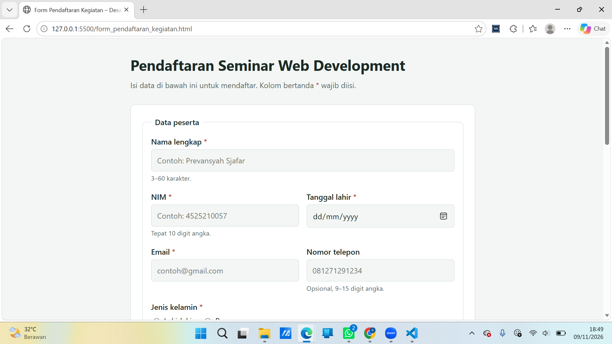
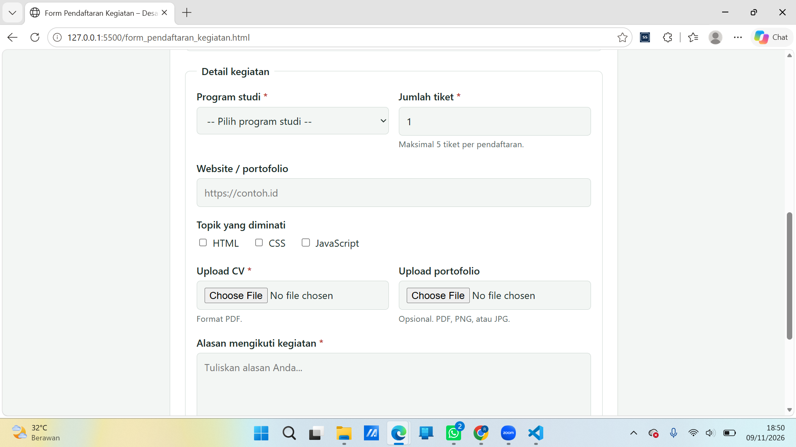
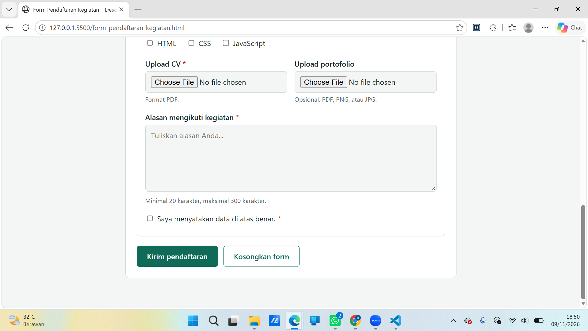
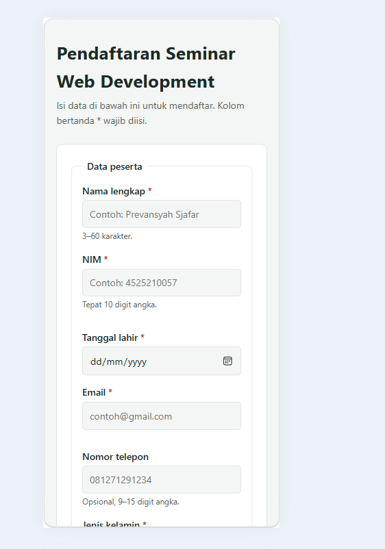

# Form Pendaftaran Kegiatan – Seminar Web Development

| | |
|---|---|
| **Nama** | Prevansyah Sjafar |
| **NPM** | 4525210057 |
| **Mata Kuliah** | Desain Web |
| **Kelas** | A |
| **Tugas** | Pertemuan 8 – HTML Form Lanjutan: Pilihan, Upload, Textarea, dan Validasi HTML5 |

## Ringkasan

Proyek ini adalah form pendaftaran seminar yang dibuat dengan HTML dan CSS. Form memuat semua komponen yang diminta pada tugas individu, yaitu radio button (jenis kelamin dan jenis peserta), checkbox (topik yang diminati), select (program studi), textarea (alasan mengikuti kegiatan), dan file upload (CV serta portofolio).

## Aturan validasi HTML5

- `required` pada kolom wajib, seperti nama, NIM, email, CV, dan alasan.
- `minlength` dan `maxlength` pada nama (3–60 karakter) dan alasan (20–300 karakter).
- `pattern="[0-9]{10}"` pada NIM agar hanya menerima tepat 10 digit angka.
- `min` dan `max` pada jumlah tiket (1–5) dan tanggal lahir.
- `type="email"` dan `type="url"` untuk memeriksa format email dan alamat website.
- `accept=".pdf"` pada upload CV sebagai pembatas jenis file.

## Perubahan, masalah, dan solusi

- **Perubahan:** menambahkan upload file, radio jenis peserta, dan textarea alasan dengan `minlength`. NIM juga disesuaikan menjadi tepat 10 digit.
- **Masalah:** form dengan upload file tidak mengirim file dengan benar jika tidak memakai `enctype`. Selain itu, `input[type=file]` belum punya gaya di CSS sehingga tampilannya tidak seragam.
- **Solusi:** menambahkan `enctype="multipart/form-data"` pada tag `<form>` dan memasukkan `input[type=file]` ke selector di `style.css`.

## Uji skenario input salah

Pengujian dilakukan dengan mengisi form lalu menekan tombol **Kirim pendaftaran**. Kolom *Hasil aktual* diisi setelah form diuji di browser.

| No | Field | Input uji | Hasil | 
|---|---|---|---|
| 1 | Nama lengkap | `Al` (2 karakter) | Ditolak browser karena kurang dari `minlength` 3 | 
| 2 | NIM | `12345#` | Ditolak karena tidak sesuai `pattern` (ada simbol) | 
| 3 | NIM | `123456789` (9 digit) | Ditolak karena kurang dari 10 digit |
| 4 | Email | `prevan.gmail.com` (tanpa `@`) | Ditolak karena format email tidak valid | 
| 5 | Jumlah tiket | `6` | Ditolak karena melebihi `max` 5 | 
| 6 | Alasan mengikuti kegiatan | `Ingin belajar` (13 karakter) | Ditolak karena kurang dari `minlength` 20 |
| 7 | Upload CV | File `.jpg` (dipilih lewat opsi "All files") | Browser bisa saja menerima karena `accept` hanya saran, sehingga pengecekan tipe file harus dilakukan di server |

## Validasi yang tetap wajib di server

Validasi HTML5 hanya berjalan di browser dan bisa dilewati, misalnya lewat DevTools atau permintaan langsung ke server. Karena itu server tetap harus memeriksa ulang format dan panjang data, rentang angka, tipe dan ukuran file yang diunggah (atribut `accept` hanya saran), serta membersihkan input dari kode berbahaya.

## Hasil Output

contoh output di tampilan dekstop 

contoh output di tampilan Mobile 

